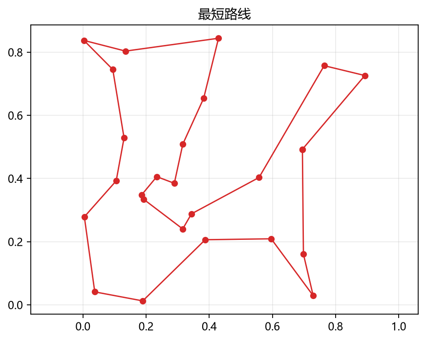
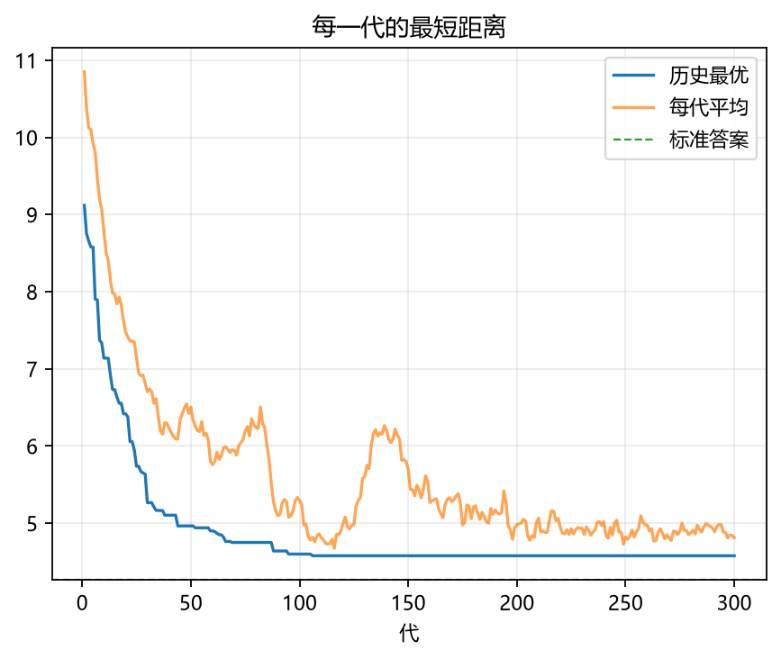

# 25 城旅行商问题

25 个城市，要找到一条把每个城市各走一遍、最后回到起点、总距离最短的路线。

程序用遗传算法来试：先随机生成一堆路线，每一代挑出好的、让它们交叉、偶尔把一段顺序倒过来，
再把差的淘汰，反复 30 代。

## 怎么用

在仓库目录里执行：

```
python main.py
```

终端会打印这些：

```
最优路线    1,14,6,...,4,23
最优距离    4.267835351807
已知最优    4.267835351807
最优差距    0.000000%
基线距离    4.267835351807
耗时        0.072 秒
```

`已知最优` 是用整数规划算出来的标准答案，`基线距离` 是换个简单办法直接算出来的结果，都拿来对比。

同时在 `output/` 里生成两张图：

`route.png` —— 最短的路线长什么样



`fitness.png` —— 每一代的最短距离怎么降下来（绿虚线是标准答案）



## 想看纯遗传算法差多少

```
python main.py --pure
```

`--pure` 关掉 2-opt（每代顺手把路线里交叉的两条边换开这一步）。不做这一步，纯遗传算法
平均差 3% 左右，30 次里只有 4 次能撞上标准答案。

其他参数看 `python main.py --help`。
